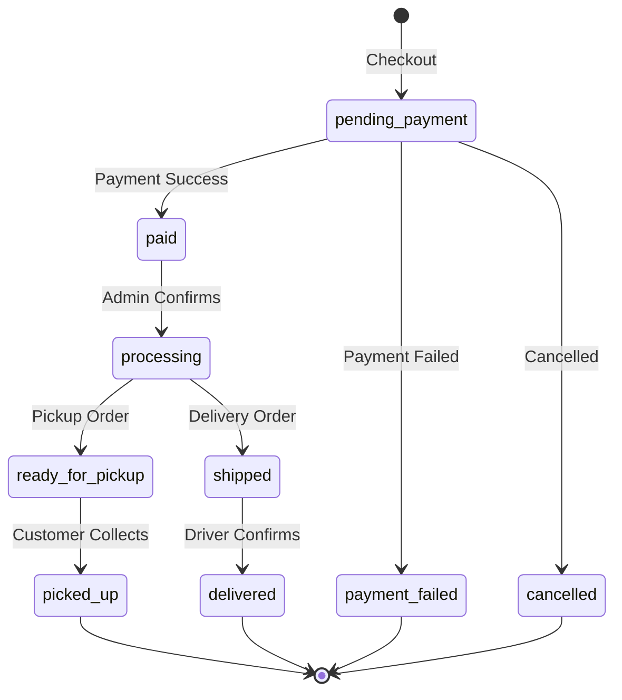

# SwimBuddz Store - Operational Playbook

## Overview

This document covers day-to-day operations for the SwimBuddz e-commerce store, including order management, inventory, and fulfillment workflows.

---

## Quick Reference URLs

| Environment | Store URL | Admin URL |
|-------------|-----------|-----------|
| Local | http://localhost:3000/store | http://localhost:3000/admin/store |
| Staging | TBD | TBD |
| Production | TBD | TBD |

---

## Order Lifecycle

### Status Descriptions

| Status | Description | Next Actions |
|--------|-------------|--------------|
| `pending_payment` | Order created, awaiting Paystack payment | Customer pays via Paystack |
| `paid` | Payment confirmed via webhook | Admin moves to `processing` |
| `processing` | Admin is preparing the order | Assign to fulfillment |
| `ready_for_pickup` | Ready at pickup location | Notify customer |
| `shipped` | Out for delivery | Add tracking number |
| `picked_up` | Customer collected at location | Done |
| `delivered` | Delivered to customer address | Done |
| `cancelled` | Order cancelled (before ship) | Refund if needed |
| `refunded` | Full refund issued | Done |

---

## Daily Operations Checklist

### Reviewed preorder item corrections

An unsettled preorder upgraded to a higher-priced SKU keeps its original receipt
and adds a separate payment for the price difference. Record an audited item and
supplier snapshot correction; do not overwrite a frozen payment or post the full
revised total as new cash. Hold order fulfillment until both receipts are verified
and total the corrected order amount. This is currently an operator repair,
not an Admin exchange button. See the backend
`docs/STORE_ORDER_CORRECTION_RUNBOOK.md` for the scoped Esther correction and
the existing receipt-verification/replay sequence.

### Morning (Opening)
- [ ] Check new orders in admin panel (`/admin/store/orders`)
- [ ] Review any `paid` orders that need to move to `processing`
- [ ] Check inventory for low-stock alerts

### Throughout Day
- [ ] Process orders: mark as `ready_for_pickup` or `shipped`
- [ ] Update tracking numbers for delivery orders
- [ ] Respond to customer inquiries

### Evening (Closing)
- [ ] Reconcile pickup orders collected today
- [ ] Update delivery statuses

---

## Admin Panel Quick Guide

### Viewing Orders
1. Navigate to **Admin → Store → Orders**
2. Use filters: All, Pending, Paid, Processing, etc.
3. Click order number to view details

### Updating Order Status
1. Open order detail page
2. Use "Quick Actions" buttons or dropdown
3. Add admin notes if needed
4. System logs all changes for audit

### Adding Tracking Number (Delivery Orders)
1. Open order detail
2. Enter tracking number in "Fulfillment" section
3. Mark as `shipped`
4. Customer receives notification

---

## Inventory Management

### Low Stock Alerts
- System alerts when quantity drops below threshold (default: 3)
- View low stock items: **Admin → Store → Inventory → Low Stock**

### Restocking
1. Go to **Admin → Store → Inventory**
2. Find the variant to restock
3. Click "Adjust" and enter quantity
4. Add notes for record keeping

### Stock Movements Tracked Automatically
- `reservation`: Stocked customer checkout reserves stock immediately (`quantity_reserved += qty`, reducing Available without dropping physical On-Hand yet). Paid `preorder` orders do not reserve at checkout, but automatically claim arriving stock **FIFO** (oldest paid preorder first) as soon as a PO Goods Receipt, Admin Restock, restockable return, or cancelled reservation adds available stock.
- `sale`: Physical stock (`quantity_on_hand`) is deducted **once on handover** (`picked_up` or `delivered`) along with moving weighted-average COGS (or an explicit `sale_unvalued` cost event if unvalued). Both `stocked` and `preorder` items strictly require received stock on hand before handover (`409` otherwise); supplier-direct `dropship` items skip warehouse counts and log an explicit `sale_unvalued` cost event for Finance.
- `release`: Unfulfilled order cancellation releases its reservation back to Available and immediately reallocates FIFO to the next waiting paid preorder if any exists.
- `restock` / `return`: Admin goods receipt, manual restock, or `restockable` return inspection adds stock to `quantity_on_hand` and runs FIFO preorder allocation.
- `adjustment`: Audited manual stock-count correction.

### Per-Variant "Continue Selling When Out of Stock" (Backorders)
- On any `stocked` product, admins can enable **Continue selling when out of stock (pre-order)** per variant (or for all active variants at once) under **Admin → Store → Products → Edit → Variants**.
- Variants with stock `> 0` sell immediately as **In stock**; variants with stock `0` and backorder **enabled** show as **Pre-order** (amber indicator + `Pre-order Now` CTA) and automatically join the FIFO preorder queue when stock arrives; variants with stock `0` and backorder **disabled** remain viewable with an out-of-stock slash/strikethrough and disabled purchase buttons.

---

## Cancellation, Returns, Exchanges & Refund Policy (ADR-024)

SwimBuddz separates **pre-handover cancellations/modifications** from **post-handover returns/exchanges**, and distinguishes **stocked** items from **preorder/dropship** items:

| Situation | Policy |
|---|---|
| Unpaid order (`pending_payment`) | Customer may self-cancel after live payment verification (blocked if a bank-transfer proof is `pending_review`) |
| Paid, `awaiting_preparation`, all `stocked` items | **Immediate self-cancel** (full refund to original tender; Paystack API refund auto-initiated; bank transfer queued for verified payout) |
| Paid, `awaiting_preparation` (same-price size/color change) | **Immediate same-price variant swap** (atomic inventory swap, no payment mutation) |
| Paid `preorder` / `dropship` / `consignment`, OR `processing` / `ready_for_pickup` | **Cancellation request** reviewed by admin (target: 1 business day) against supplier PO commitment & bag packing |
| `shipped` (in transit) | Cancellation closed; transitions to post-delivery return/exchange once received |
| Wrong size / change of mind after pickup or delivery (non-defective) | **7-day return/exchange window** for unused items (swimwear must be unworn with hygiene seal & tags intact). Remedy: **size/color exchange, Store Credit, or Bubbles**. Original ₦2,000 delivery fee is non-refundable; customer drops off at a pool session (free) or covers return dispatch. |
| Defective, damaged, misdescribed, or wrong item supplied | **FCCPA statutory remedy** (overrides change-of-mind & swimwear hygiene restrictions): **full cash refund to original payment method (including delivery fee)** or **free replacement**. |

### Admin Workflow
1. **Cases Queue (`/admin/store/cases`):** Review open `cancel_request`, `return_exchange`, and `defect_claim` cases within **1 business day**. Declines require a clear reason; policy overrides require an explicit `override_reason`.
2. **Return Receipt & Inspection:** When physical goods arrive back at a pool session or office, record inspection condition (`restockable`, `damaged`, or `hygiene_unsellable`). Only `restockable` items return to sellable stock and reverse weighted-average COGS.
3. **Refund Execution (`/admin/payments` → Refunds):**
   - **Paystack refunds:** Auto-initiated on self-cancel/approval or triggered via **Initiate Paystack Refund** (reconciled via `refund.processed` webhook or manual **Sync Status**; Paystack settles back to customers in 3–10 working days).
   - **Manual bank transfer refunds:** Verify customer NUBAN account name via Paystack account lookup, transfer from Stanbic IBTC (`0079760600`) within **2 business days**, and record the verified bank transaction reference to mark completed.
   - **Never cancel a paid order via the raw status dropdown:** Always use **Cancel & Issue Refund** on `/admin/store/orders/[id]` or approve a case so inventory, store credits, Bubbles, refunds, and ledger entries stay balanced.

---

## Pickup Locations

| Location | Address | Hours |
|----------|---------|-------|
| Rowe Park Pool | Rowe Park, Yaba, Lagos | Tue-Sun 6am-8pm |
| Lekki Swimming Center | 123 Admiralty Way, Lekki Phase 1 | Mon-Sun 7am-7pm |
| VI Sports Complex | Victoria Island, Lagos | Mon-Sat 8am-6pm |

### Pickup Process
1. Customer shows order number at reception
2. Staff verifies identity (email or phone)
3. Staff marks order as `picked_up` in admin
4. Customer signs acknowledgment

---

## Delivery Process

1. Delivery fee: ₦2,000 flat rate
2. Driver assigned when order `processing`
3. Update status to `shipped` with tracking
4. Driver confirms delivery → `delivered`

---

## Payment Integration

### Paystack Flow
1. Customer completes checkout → Order created (PENDING_PAYMENT)
2. Frontend calls payments API → Paystack checkout URL
3. Customer pays on Paystack
4. Webhook received → Order marked PAID
5. Admin notified of new paid order

### Manual Verification (Fallback)
If webhook delayed, customer can trigger verification from billing page.

---

## Troubleshooting

### Order stuck on "pending_payment"
- Customer may not have completed Paystack payment
- Check Paystack dashboard for transaction status
- If paid in Paystack but not reflected, check webhook logs

### Inventory mismatch
- Check inventory movements log
- Look for failed reservations
- Manual adjustment may be needed with notes

### Customer can't find order
- Search by order number or email in admin
- Verify customer email matches order

---

## Emergency Contacts

| Role | Contact |
|------|---------|
| Product Issues | [Store Manager TBD] |
| Technical Issues | [Dev Team TBD] |
| Paystack Support | [Paystack Dashboard] |

---

## API Endpoints Reference

### Public (Store Frontend)
- `GET /api/v1/store/products` - List products
- `GET /api/v1/store/products/{slug}` - Product detail
- `GET /api/v1/store/cart` - Get cart
- `POST /api/v1/store/cart/items` - Add to cart
- `POST /api/v1/store/checkout/start` - Start checkout

### Admin
- `GET /api/v1/store/admin/orders` - List all orders
- `PATCH /api/v1/store/admin/orders/{id}/status` - Update status
- `POST /api/v1/store/admin/products` - Create product
- `PATCH /api/v1/store/admin/inventory/{id}` - Adjust stock

---

*Last updated: January 2026*

### Reviewed purchased stock correction — 24 November 2026

The owner approved Stocked sourcing for eight purchased product families and five units remaining per purchased variant after Fatima’s collected items. The scoped backend runbook `docs/STORE_STOCK_RECONCILIATION_20261124.md` records count adjustments and explicit reservations, then uses normal Picked Up completion. Retain original preorder history and verified payments. Unpurchased variants are not stocked automatically. Acquisition cost stays unknown until supported independent valuation; this operation posts no new cash or invented COGS.
